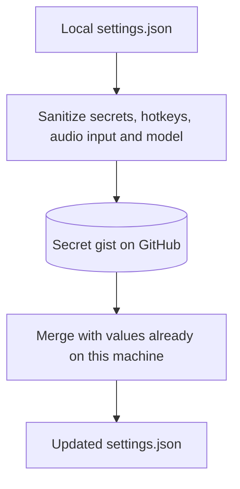

# Hex Sync

[](https://github.com/callmeteus/hex-sync/actions/workflows/release.yml)
[](https://www.rust-lang.org/)
[](https://github.com/callmeteus/hex-sync)
[](LICENSE)

> One secret gist. The same Hex setup on Linux and Windows.

Hex Sync is a small Rust CLI that keeps the portable parts of Hex's `settings.json` in a GitHub gist. Push after you change a shortcut or a transcription mode, pull on the other machine, and keep working. Credentials, capture devices, file paths and local state stay on each machine.

## Contents

- [Why](#why)
- [Features](#features)
- [How it works](#how-it-works)
- [Prerequisites](#prerequisites)
- [Installation](#installation)
- [Updates](#updates)
- [CLI configuration](#cli-configuration)
- [Quick start](#quick-start)
- [Commands](#commands)
- [Automatic sync](#automatic-sync)
- [Change history](#change-history)
- [What stays local](#what-stays-local)
- [Configuration](#configuration)
- [Platform details](#platform-details)
- [Security](#security)
- [Project layout](#project-layout)
- [License](#license)

## Why

Hex stores its configuration in a single `settings.json`. Copying that file between machines is tempting, but it also carries API keys, the selected microphone, absolute folder paths and app bookkeeping. Those values are machine-specific and some of them are secrets.

This tool syncs the settings you actually want to share and leaves everything else where it belongs.

## Features

- Bidirectional sync through a GitHub gist: `push`, `pull` and a read-only `diff`.
- An optional daemon that watches both sides and syncs changes automatically.
- A signed change log inside the gist that records which machine, user and OS changed it.
- Works on Linux and Windows with the same commands and the same gist.
- Secret gist by default, with an opt-in `--public` flag.
- Credentials and machine-specific fields are replaced before upload and restored on download.
- Timestamped backup of `settings.json` before every `pull`.
- No runtime dependencies beyond the GitHub CLI. No Python, bash or jq required.
- `self-update` downloads the latest release binary directly from GitHub.

## How it works



Values that must stay local are replaced with the sentinel `__HEX_SYNC_LOCAL__` before upload. On `pull`, each sentinel is replaced with the value already present in the local file. On a fresh machine, the key is omitted so Hex uses its own default.

The gist file uses a versioned wrapper with a signature and a `settings` object, so more sync destinations can be added later without changing the local file format.

Runtime files such as `history.json`, `local-api.json`, `session.env` and token files are never read or uploaded. Only `settings.json` is involved.

## Prerequisites

- [GitHub CLI](https://cli.github.com/) installed and authenticated with `gh auth login`. `GH_TOKEN` and `GITHUB_TOKEN` also work.
- Rust 1.70 or newer to build from source.

## Installation

Prebuilt binaries for Linux and Windows are attached to every [GitHub release](https://github.com/callmeteus/hex-sync/releases). Download the one for your platform and put it on your `PATH`.

To build from source:

```bash
git clone https://github.com/callmeteus/hex-sync.git
cd hex-sync
cargo install --path .
```

To build without installing into `~/.cargo/bin`:

```bash
cargo build --release
```

The binary is written to `target/release/hex-sync`, or `hex-sync.exe` on Windows. The `cargo install --path .` command works the same way in PowerShell and Git Bash, as long as `cargo` is on your `PATH`.

## Updates

```bash
hex-sync self-update
hex-sync self-update --force
```

The command asks GitHub for the latest release, checks that a binary exists for this platform, downloads it with `gh release download` and replaces the running executable. On Windows the swap is applied by a small detached batch script right after the process exits, because Windows locks running executables. Use `--force` to reinstall the same version.

The `watch` daemon checks GitHub every six hours and prints a notice when a newer release exists. It never replaces the binary on its own.

## CLI configuration

Hex Sync keeps its own settings in `hs-settings.json`, stored in the Hex data folder next to Hex's `settings.json`:

```json
{
  "version": 1,
  "gistId": "0123456789abcdef0123456789abcdef"
}
```

The `gistId` is written there by `init` and `use`. The file is ours, not Hex's, so Hex's `settings.json` is never replaced by it. It is also where future sync destinations will be configured. The old plain-text `gist-id` file is still read for compatibility, and `HEX_GIST_STATE_FILE` can point elsewhere.

## Quick start

On the first machine:

```bash
hex-sync init
```

```text
Gist ID saved to: /home/you/.local/share/hex/hs-settings.json
Gist created: https://gist.github.com/you/0123456789abcdef0123456789abcdef
```

The gist is secret by default, so it is not publicly listed but remains accessible by URL. Use `hex-sync init --public` if you really want it listed.

On a first run with no local config, `init` (and `watch`) searches your GitHub gists for Hex settings. If it finds any, it lists the gist ID, description, last update and the machines that changed it, then asks which one to use. Press Enter to create a new gist instead. The search only runs in an interactive terminal.

On the second machine:

```bash
hex-sync use https://gist.github.com/you/0123456789abcdef0123456789abcdef
hex-sync pull
```

You can also skip storing the gist ID:

```bash
HEX_GIST_ID=0123456789abcdef0123456789abcdef hex-sync pull
```

## Commands

| Command | Description |
| --- | --- |
| `init [--public]` | Create a gist from the current settings and save its ID locally. |
| `use <id\|url>` | Point this machine to an existing gist. |
| `push` | Upload sanitized local settings to the gist. |
| `pull` | Download settings and merge local values back into them. |
| `diff` | List the paths that differ between the local file and the gist. |
| `watch [--interval <seconds>]` | Run the sync daemon in the foreground. |
| `history [--revisions]` | Show the signed change log, or native GitHub gist revisions. |
| `self-update [--force]` | Replace the binary with the latest GitHub release asset. |
| `service install` | Install the daemon as a systemd user service or a scheduled task. |
| `service uninstall` | Remove the automatic sync service. |
| `help` | Print usage and environment variables. |

The old `install-service` and `uninstall-service` names still work as aliases.

The tool never picks a sync direction for you in `push`, `pull` or `diff`. If `diff` reports a difference, choose `push` or `pull` explicitly.

## Automatic sync

`watch` polls the local `settings.json` and the gist, then reacts to the side that changed:

```bash
hex-sync watch
hex-sync watch --interval 30
```

The default interval is 15 seconds and can also be set with `HEX_SYNC_INTERVAL`. Press Ctrl+C to stop the foreground process.

Only changes to portable settings trigger a sync. Editing a local credential or microphone changes nothing in the gist, because those values are sanitized away before comparison. If both sides change before the daemon notices, it reports a conflict and waits for you to resolve it with `push` or `pull`. It never overwrites one side with the other automatically.

To run it at login instead of keeping a terminal open:

```bash
# Linux: creates ~/.config/systemd/user/hex-sync.service, enables and starts it
hex-sync service install
systemctl --user status hex-sync.service

# Windows: creates a "HexGistSync" task that runs on logon and starts it now
hex-sync service install
```

Remove it with `hex-sync service uninstall`. On Linux this disables and deletes the service file; on Windows it deletes the scheduled task.

The service inherits the gist ID from the local state file. If you rely on `HEX_GIST_*` environment variables instead, run `service install` from a shell where those variables are set so they can be written into the service definition. Authentication comes from the GitHub CLI config, so no token is stored in the service file.

## Change history

GitHub gists keep their own revisions, but those revisions do not record which machine made a change. Hex Sync therefore writes a signature block into the gist file itself:

```json
{
  "format": "hex-sync/v1",
  "signature": {
    "tool": "hex-sync",
    "version": 1,
    "history": [
      {
        "at": "2026-11-18T19:23:01Z",
        "machine": "linux-box",
        "user": "gio",
        "os": "linux",
        "action": "push"
      }
    ]
  },
  "settings": { "...": "..." }
}
```

Every `push`, `init` and daemon sync appends an entry with the hostname, user, OS, UTC timestamp and action. The last 50 entries are kept. The wrapper is stripped on `pull`, so your local `settings.json` never sees this metadata.

```bash
hex-sync history
```

```text
2026-11-18T19:23:01Z | init | linux-box | gio | linux
2026-11-18T19:23:01Z | push | win-box  | teus | windows
```

To see GitHub's own revision list instead:

```bash
hex-sync history --revisions
```

Gists created by older versions contain plain settings and still work. The first push upgrades them to the signed format.

## What stays local

| Setting | Reason |
| --- | --- |
| Keys matching `apiKey`, `token`, `secret`, `password`, `credential`, `auth` | Credentials must never leave the machine. |
| `microphone`, `avoid_bluetooth_microphone`, `transcription_device` | Audio input is tied to the hardware on this machine. |
| `transcription.model`, `transcription_recents`, `capture.transcriber`, `keyboard_model_switching` | The input model is a local choice, not a shared preference. |
| `experimental.hex_microphone*` | Virtual microphone behavior depends on the local setup. |
| All `*_hotkey` fields, `shortcut_mode`, `double_tap_*`, `gnome_keyboard_shortcuts`, `share_dictation_shortcut` | Keybinds are configured per machine. |
| `meetings.output_folder`, `capture.folder`, `screenshots.folder` | Absolute paths differ between machines and users. |
| `capture.routing.jev`, `jevApiKey`, `agentHost`, `agentOpencode` | Integration endpoints and their credentials. |
| `migrations` | Internal application bookkeeping. |

Everything else is merged. Vocabulary boosts, dictation modes, replacements, transformations and post-processing prompts are shared, while the keys above are read from the local file on every `pull`. A credential added locally after the last `push` is also preserved later.

If a machine has no local value for a machine-only field, `pull` omits that key instead of writing `null`, so Hex uses its own default.

## Configuration

| Variable | Purpose |
| --- | --- |
| `HEX_GIST_ID` | Gist ID, takes precedence over the state file. |
| `HEX_SETTINGS_PATH` | Path to Hex's `settings.json`. |
| `HEX_GIST_FILE` | Filename inside the gist, default `hex-settings.json`. |
| `HEX_GIST_STATE_FILE` | Where the gist ID is stored. |
| `HEX_GIST_PUBLIC` | Set to `1` with `init` to create a public gist. |
| `HEX_SYNC_INTERVAL` | Default `watch` interval in seconds, default 15. |

## Platform details

| | Linux | Windows |
| --- | --- | --- |
| Hex settings file | `$XDG_DATA_HOME/hex/settings.json` or `~/.local/share/hex/settings.json` | `hex/settings.json` or `anomaly/hex/settings.json` under `%APPDATA%` or `%LOCALAPPDATA%` |
| CLI config | `~/.local/share/hex/hs-settings.json` | `%APPDATA%\hex\hs-settings.json` |
| Binary | `hex-sync` | `hex-sync.exe` |

The CLI config lives in the Hex data folder, right next to Hex's `settings.json`, so one folder carries both. If you set `HEX_SETTINGS_PATH`, the config follows that directory by default. Old `gist-id` files in the same folder or in `~/.config/hex-gist-sync` are still read. `HEX_GIST_STATE_FILE` overrides the location.

The first existing settings file wins. If Hex stores its configuration somewhere else on your system, set `HEX_SETTINGS_PATH`.

Close Hex before running `pull` and reopen it afterwards. Otherwise the app may overwrite the new file with the state it still holds in memory. The same applies on both platforms.

## Security

Gists are secret by default. Review the gist contents before using `--public`, since post-processing modes can contain custom prompts and routing rules. If a credential ever leaks, revoke and regenerate it; deleting the gist is not enough.

## Project layout

```text
hex-sync/
├── Cargo.toml
├── Cargo.lock
├── README.md
└── src/
    └── main.rs
```

## License

MIT
